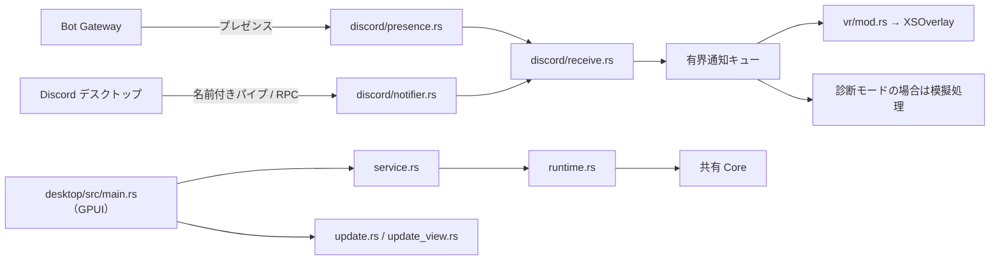

# DiToVR の内部構造

v0.4.0 から、製品本体は Rust のネイティブ UI（GPUI）です。共有 Core（`src/`）を `desktop/` の `runtime.rs` が起動し、画面はその状態（`View`）を読み、操作は `execute` で送ります。v0.3.x までの Tauri／React 構成は Git 履歴とタグ（v0.3.1 以前）に残っています。最近の内部整理の記録は [docs/refactoring/](docs/refactoring/) にあります。

## 通知・音声・認証

| ファイル | 責務 |
| --- | --- |
| `src/discord/ipc.rs` | Discordの Windows 名前付きパイプ探索、フレーム上限、タイムアウト、PING/PONG |
| `src/discord/notifier.rs`、`context.rs` | OAuthの AUTHORIZE → token交換 → AUTHENTICATE、再接続と購読、自分の通知・重複の除外、サーバー・チャンネル名の期限付き取得 |
| `src/discord/receive.rs`、`presence.rs` | 通常・許可リスト・Bot自動判別のポリシーと Gateway プレゼンス監視 |
| `src/vr/mod.rs` | WebSocket（localhost:42070）、再接続、送信直前のモード・受信可否の再確認、画像取得の制限、通知パスとJSON |
| `src/audio.rs` | 音源の検証、MP3/WAVからOgg Vorbisへの変換とキャッシュ。音源は最大16 MiB・120秒 |
| `src/diagnostics.rs`、`src/system/mod.rs` | 件数・理由・時刻のメモリ内診断、DPI処理、SteamVR 終了検知 |

通知の受信条件と表示モードは別。通常通知は `NOTIFICATION_CREATE`、許可リストの会話は `MESSAGE_CREATE` で取得する。Discord RPC の基本権限は `rpc` / `rpc.notifications.read`。リストが空でなければ `messages.read` が加わる。Bot 利用時は同一ユーザーか確認し、オンライン・退席中は通常受信、判定不能・切断時を含むそれ以外は許可リストに制限する。

キューは64件、期限は15秒。切断や期限切れで古い通知を破棄し、復帰後の遅延再送を避ける。通知音のみでも XSOverlay が必要。音源と正の音量を検証し、VR送信時は名前・本文・アイコンを省く。WebSocket書込成功を VR の描画や再生成功として扱わない。

## 製品の設定・画面・配布

- `src/config/mod.rs` が設定と検証を定義し、`storage.rs` が DPAPI と原子的書き込みを扱う。新しい設定を優先し、旧フォルダーや exe 隣からの移行は `desktop/src/paths.rs` が行う。設定の読込・復号失敗時に元のデータを上書きしない。復号する認証情報は `decode_secrets` に集約している。
- `desktop/src/main.rs` が画面シェルと状態、`refinement.rs` が通知画面、`controls.rs` / `theme.rs` / `motion.rs` が部品・色・動き、`connections.rs` と `allowlist.rs` が接続フォーム、`settings.rs` がスイッチ処理、`draft.rs` が編集内容と保存済みスナップショットを管理する。`shell.rs` は単一起動・トレイ・ウィンドウ表示を扱う。
- `desktop/src/service.rs` が画面と `runtime.rs` の非同期連携を担う。`Runtime::execute` は内部で `block_on` するため、UI スレッドや Tokio のタスク上では呼ばず、背景スレッド（GPUI の background executor／`spawn_blocking`）から呼ぶ。`runtime.rs` は専用の Tokio ランタイムを持ち、コマンドは状態ロックで直列化される（旧 OAuth タスクを止めてから資格情報を差し替えるため）。
- `desktop/src/update.rs` が通常版の署名付き更新（フィード取得、サイズ上限、minisign 署名とバージョン検証、固定配布先、インストーラー起動）、`update_view.rs` が設定画面の更新欄と初回案内を扱う。更新は独自の Tokio ランタイムで動く。Store 版（`microsoft-store` feature）は更新コードを外し、Store が管理する。配布ガイドは [通常更新](docs/AUTO_UPDATE.md) と [Store](docs/MICROSOFT_STORE.md)。
- 起動モード: `--debug`（Discord 受信の診断のみ。XSOverlay・更新は使わない）、`--ui-preview`（ダミー表示。外部接続・保存・更新なし）。
