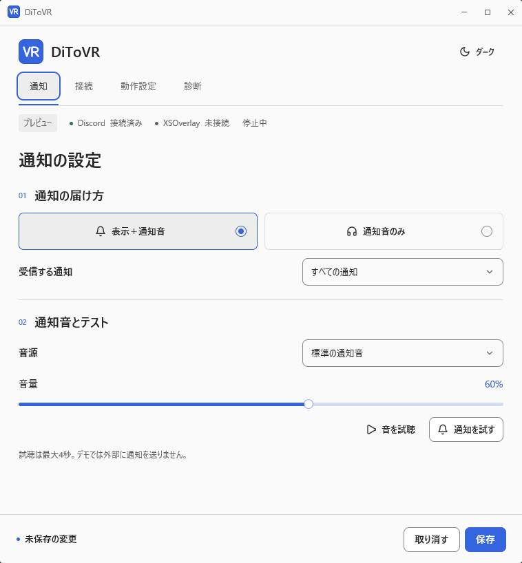
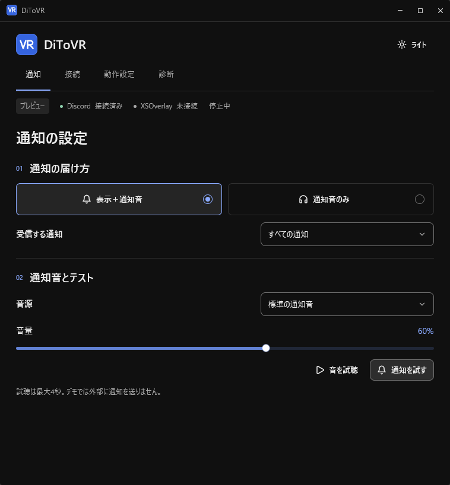
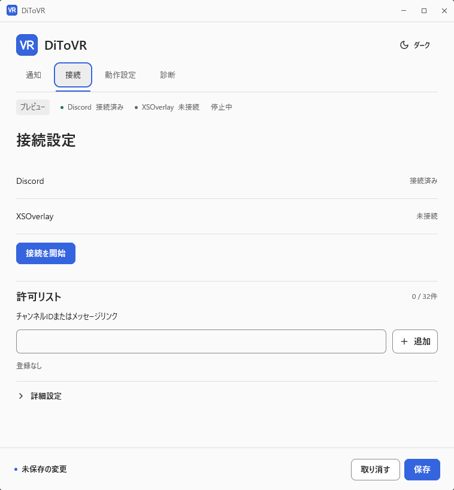
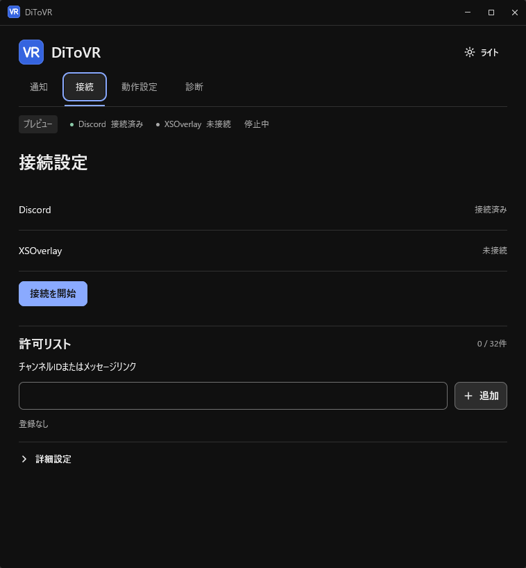
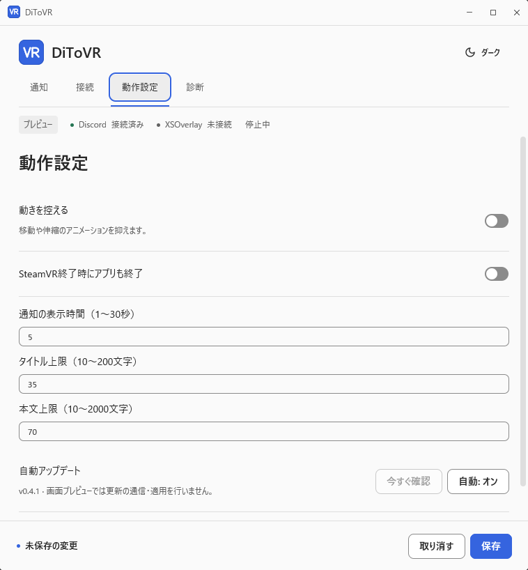
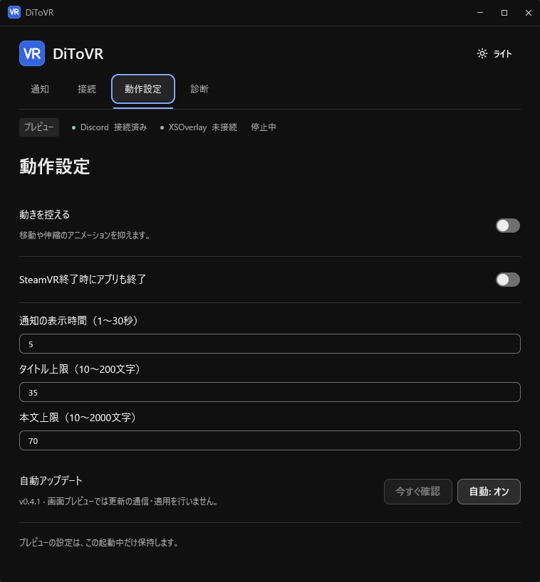
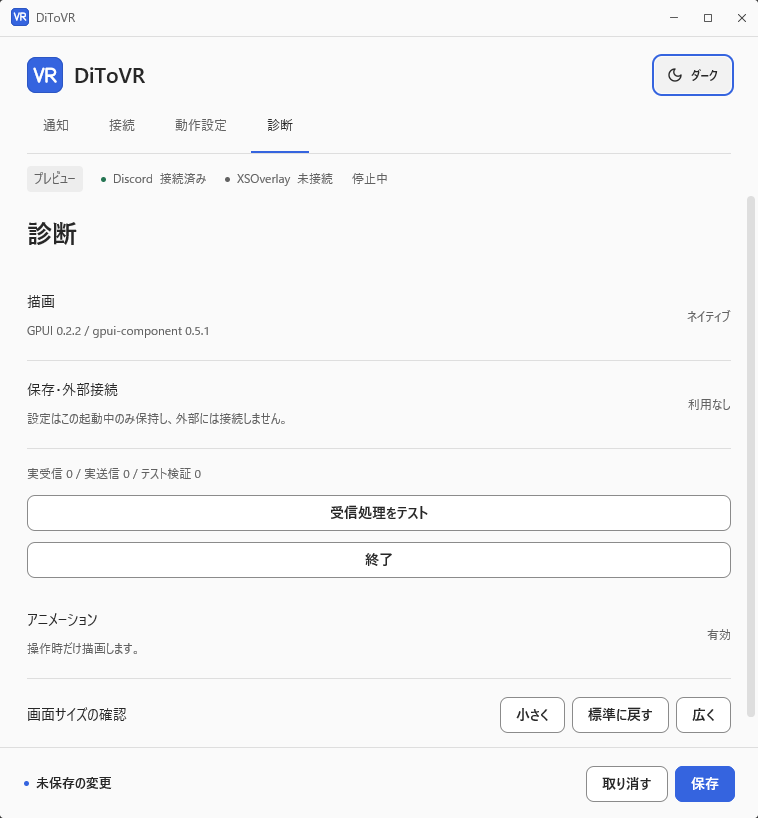
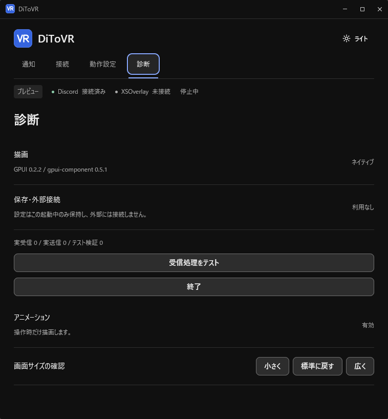

# 操作画面の使い方

v0.4.0 から、画面は Rust のネイティブ UI（GPUI）です。上部のタブ「通知」「接続」「動作設定」「診断」で切り替えます。掲載画像は `--ui-preview` で起動したダミー情報の表示例で、実際の接続・保存・通信は行っていません。インストールと最初の接続は [README](../README.md) を参照してください。

| タブ | できること |
| --- | --- |
| 通知 | 接続状態の確認、通知の届け方（表示＋通知音／通知音のみ）、受信する通知の選択、通知の一時停止、通知音の試聴とテスト |
| 接続 | Discord の Client ID・Client Secret・Redirect URI、許可リスト、Bot による状態判別 |
| 動作設定 | テーマ、通知の表示時間、タイトル・本文の上限、SteamVR 終了時の自動終了、自動アップデート |
| 診断 | 実受信・実送信・テスト検証の件数、受信処理のテスト |

## 初回の案内

設定が未完了のとき、通知タブに「最初の接続を整えましょう」が表示されます。「開発者ポータルを開く」で Discord の開発者ポータルを開き、自分のアプリを作ります。「接続設定を開く」で接続タブへ移り、Client ID と Client Secret を入力します。「あとで」で案内を閉じられます。

## 通知タブ

- **接続状態**: Discord と XSOverlay の接続を確認します。両方が「接続済み」になると VR に通知が届きます。
- **通知の届け方**: 「表示＋通知音」は名前・本文・アイコンを XSOverlay に表示して音を鳴らします。「通知音のみ」は本文を表示せず、通知音だけを鳴らします。どちらも XSOverlay が必要で、選んだ内容は次回起動にも引き継ぎます。起動時の `--sound-only` / `--normal` でも指定できます。
- **受信する通知**: 「すべての通知」は Discord が通常の通知として出した会話を受信します。「許可リストのみ」は登録した会話だけを、Discord が取り込み中でも受信します。「Discordの状態で自動判別」は Bot で自分の状態を確認し、オンライン・退席中は通常どおり、それ以外は許可リストだけを受信します。
- **通知の一時停止**: Discord からの通知受信を停止・再開します。
- **通知音**: 「標準の通知音」または MP3・WAV・Ogg Vorbis の音声ファイル（16 MiB・120 秒以下）を選び、音量を 1% 以上にしてください。MP3・WAV はアプリ内で自動変換し、元ファイルは変更しません。「音を試聴」はこの PC で最大 4 秒ローカル再生するだけで、VR には送りません。
- **通知を試す**: 保存した設定で XSOverlay にテスト通知を送ります。送信待ちに追加されるため、実際に VR 内で表示されたことを確認してください。

×はトレイへの格納です。格納中も通知の転送は続きます。トレイのアイコンを選ぶか、ショートカット・実行ファイルをもう一度開くと、起動済みの画面へ戻ります。アプリを止めるときはトレイの「終了」を選びます。

## 接続タブ

自分の Discord アカウントで作ったアプリの Client ID・Client Secret・Redirect URI を入力して保存します。Portal の Redirects と入力した Redirect URI は一致させてください。Secret と Token は Windows ユーザーに紐づけて暗号化保存します。保存済みの値は画面へ読み戻さず、欄を空欄にしておけば現在の値を保持します。

保存すると、受信中だった場合は自動で接続を再開します。設定ファイルを直接編集した場合は再起動が必要です。

## 動作設定タブ

テーマ（ライト・ダーク）、通知の表示時間（1〜30 秒）、タイトル上限（10〜200 文字）、本文上限（10〜2000 文字）、「SteamVR終了時にアプリも終了」を設定します。「自動アップデート」でバージョンと進行状況を確認でき、「今すぐ確認」で確認を始めます。インストーラー版は新版を自動でダウンロード・検証し、適用後に再起動します。設定を編集中は閉じるまで待機します。Microsoft Store 版の更新は Store が管理します。詳細は [自動アップデート](AUTO_UPDATE.md) を参照してください。

設定は `%APPDATA%\DiToVR\config.json` に保存します。以前の保存先にある設定は、新しい保存先に設定がない場合に引き継ぎ、旧ファイルは残します。アンインストールは [README の案内](../README.md#アンインストールするには) を参照してください。

## 受信できているか確認する

診断タブでは、描画やアニメーションの状態、保存した設定を使っているか（プレビューでは外部に接続しません）、実受信・実送信・テスト検証の件数を確認できます。「終了」でアプリを終了します。「受信処理をテスト」は、本番と同じメッセージ処理・キューの判定・通知の組み立てを使い、送信の直前で止めます。Discord 認証・実際の Bot 接続・実際のチャンネル購読が成功したことを証明するテストではなく、実受信の件数も増えません。診断は日時と固定の処理結果だけをメモリに保持し、本文・送信者名・ID・秘密情報は保存しません。

Discord から実際に届いているかだけを確認したいときは、いったんアプリを終了し、`DiToVR.exe --debug`（`-debug` も可）で起動します。XSOverlay・SteamVR は不要で、この起動中は XSOverlay に接続・送信せず、VR 終了による自動終了も行いません。別のアカウントなどから Discord が通知を出すメッセージを受信し、実受信の件数が増えれば、アプリにイベントが届いています。

## 取り込み中も必要な会話を受信する

許可リストを使います。接続タブの「許可リスト」で、取り込み中やミュート中でも受信したい会話を登録します。

1. Discord の「詳細設定」で開発者モードを有効にします。チャンネルを右クリックして ID をコピーするか、DM を含むメッセージのリンクをコピーします。
2. 「チャンネルIDまたはメッセージリンク」に貼り付けて「追加」を押します。DM は相手のユーザー ID ではなく、その会話のチャンネルを登録します。最大 32 件です。
3. 保存し、必要なら Discord のメッセージ読み取り権限（`messages.read`）を承認します。
4. 通知タブの「受信する通知」で「許可リストのみ」を選びます。登録先へのアクセス権が必要です。

許可リストのみを受信する間は、登録先のミュートやメンション限定などの設定によらずメッセージを転送します。空の許可リストでは会話の通知を転送しません。登録先の購読に失敗した場合は案内を表示します。

## Bot で状態を自動判別する

接続タブの Bot 設定（「Botによる状態判別」）を使います。Bot は自分のステータスを判定するだけで、メッセージの取得は RPC を使います。Bot で DM を読む必要はありません。

1. [Developer Portal](https://discord.com/developers/applications) で自分のアプリを開き、Bot ページの **Privileged Gateway Intents → Presence Intent** を有効にして保存します。Message Content Intent・Server Members Intent は不要です。
2. Bot ページで発行した **Bot Token** を入力します。Discord アカウントのトークンや Client Secret をここへ入れないでください。
3. OAuth2 → URL Generator で `bot` を選び、Bot Permissions は未選択（権限 **0**）のまま生成した URL を開き、自分も参加しているサーバーへ追加します。自分専用の小さいサーバーを作っても使えます。
4. 「サーバーID」と「自分のユーザーID」を入力します。ユーザー ID は RPC で承認するアカウントと同じものを指定します。
5. 通知タブの「受信する通知」で「Discordの状態で自動判別」を選びます。

Bot Token は Windows ユーザーに紐づけて暗号化保存し、空欄のまま保存すると維持します。取り込み中、オフライン、状態不明、接続エラー、対象不在、RPC アカウント不一致では許可リストだけになります。Invisible はオフラインと区別できないため同じ扱いです。通知タブで手動のモードへ切り替えれば、いつでも上書きできます。自動判別以外では Bot 接続を停止します。

Bot の Token や Intent が誤っている場合は、設定を直して保存してください。許可リストの受信にも RPC の認証とアクセス権が必要です。実際の Discord・Bot・XSOverlay の組み合わせでの接続確認は、お使いの環境で行ってください。
